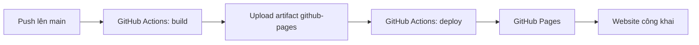

# Triển khai website FCAJ trên GitHub Pages

**Website:** https://nhatuyen2409.github.io/aws/  
**Repository:** https://github.com/NhatUyen2409/aws  
**Workflow:** [`.github/workflows/deploy.yml`](https://github.com/NhatUyen2409/aws/blob/main/.github/workflows/deploy.yml)

## Cơ chế triển khai

Website là ứng dụng tĩnh HTML/CSS/JavaScript, không cần Hugo, React, Vite hoặc Vercel.



Job `build` tạo artifact chứa tệp website; job `deploy` phụ thuộc vào `build`, sau đó xuất bản artifact lên GitHub Pages.

## Thiết lập GitHub Pages

Tại repository, mở **Settings → Pages → Build and deployment** và đặt **Source = GitHub Actions**.

Không cần chuyển sang "Deploy from a branch" khi dùng workflow deploy hiện tại.

## Quy trình phát hành

1. Kiểm tra thay đổi tại local, đặc biệt là phần Workshop và nội dung song ngữ.
2. Chạy `node --check app.js` nếu đã sửa JavaScript.
3. Commit các file mong muốn.
4. Push lên `aws/main`:

```bash
git push aws HEAD:main
```

5. Mở [Actions](https://github.com/NhatUyen2409/aws/actions) và xem workflow mới nhất.
6. Đảm bảo cả **build** và **deploy** đều hoàn thành (dấu xanh).
7. Mở https://nhatuyen2409.github.io/aws/ và kiểm tra mục đã thay đổi.

## Kiểm tra sau khi triển khai

- Trang chủ không bị trắng hoặc lỗi JavaScript.
- Có thể chuyển giữa các phần báo cáo.
- Workshop và Worklog hiển thị nội dung mới.
- CSS, bảng và ảnh hoạt động đúng.
- Nếu nội dung còn cũ, mở cửa sổ ẩn danh hoặc nhấn **Ctrl + F5**.

## Xử lý lỗi thường gặp

| Hiện tượng | Hướng kiểm tra |
| --- | --- |
| `No artifacts named github-pages` | Kiểm tra job upload, artifact name, quyền workflow và quan hệ `needs: build` |
| `build` xanh, `deploy` đỏ | Mở log job `deploy`; kiểm tra Pages Source, quyền `pages: write`, `id-token: write` |
| Website chưa cập nhật | Xem commit mới nhất trên `main`, workflow tương ứng và cache trình duyệt |
| Workshop hiển thị nội dung cũ | Kiểm tra `app.js` ở `main`, đảm bảo nội dung mới đã commit và push |
| Hình ảnh bị lỗi | So khớp đường dẫn, chữ hoa/thường và file thực tế trong repo |
| Trang con hoặc hash route sai | Kiểm tra logic điều hướng trong `app.js` và `404.html` |

## Quy tắc an toàn

- **Không sửa `deploy.yml`** chỉ để cập nhật nội dung Worklog hoặc Workshop.
- Không thêm access key, token hoặc dữ liệu nhạy cảm vào repo public.
- Không push các file backup hoặc file tạm không cần thiết.
- Không dùng `git push --force` để xử lý lỗi triển khai thông thường.
